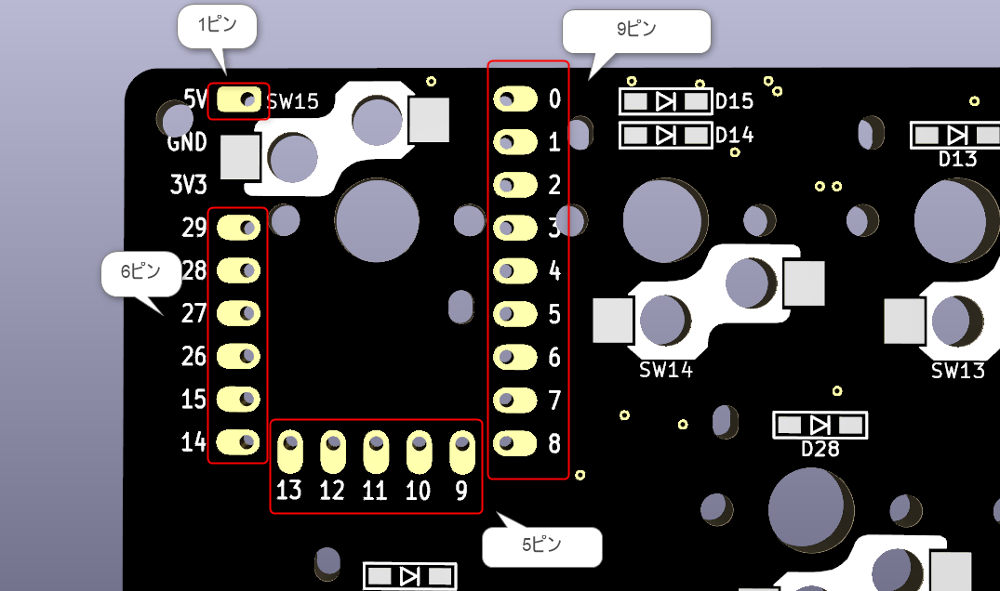

本手順はRP2040-Zeroの取り付け手順です。

# 前提
## 取り付ける向き
取り付ける向きや取り付け方はキーボードにより異なります。    
必ずPCB基板に印刷されているピンアサイン（ピンの番号）とRP2040-Zeroのピンアサインが合うように取り付けてください。  
またビルドガイドに記載されている取り付け向きなどの写真も参考にしてください。

## 使用するピン
設計の都合上、敢えて使用しないピン（＝ハンダ付けしないピン）を設けていることがあります。  
この場合はそのピンを避けるように取り付けてください。  

例えば以下のような場合は、左上の「GND」と「3V3」ピンのハンダ付けは不要です。

## ピンヘッダーとコンスルー
固定する際にピンヘッダーを使用する場合は後述の手順でハンダ付けが必要です。  

コンスルーを使用する場合はハンダ付け不要ですが、RP2040-Zeroは構造上コンスルーで取り付けた場合、USB端子の抜き差しで力が加わった際に外れやすくなっていますのでご注意ください。

# 手順
PCB基板のスルーホール（穴）の位置に合わせてRP2040-Zeroにピンヘッダーを取り付けます。

PCB基板とRP2040-Zeroのピンが正しく対応していることを確認したら、マスキングテープや逆作用ピンセット等で仮固定します。

PCB基板およびRP2040-Zeroから飛び出しているピンヘッダーのピン部分をニッパー等で切り取ります。

ピンを両面ともハンダ付けします。

これでRP2040-Zeroの取り付けは完了です。