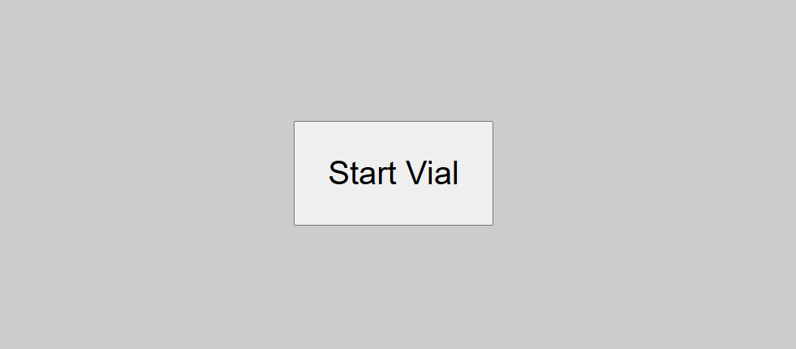
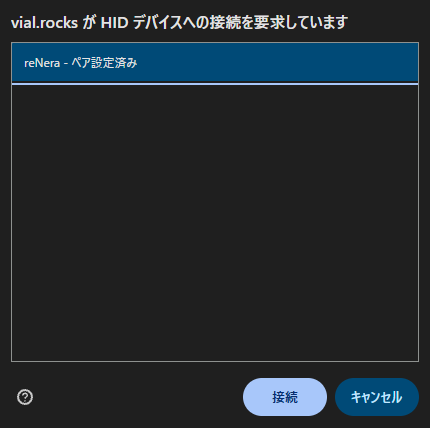
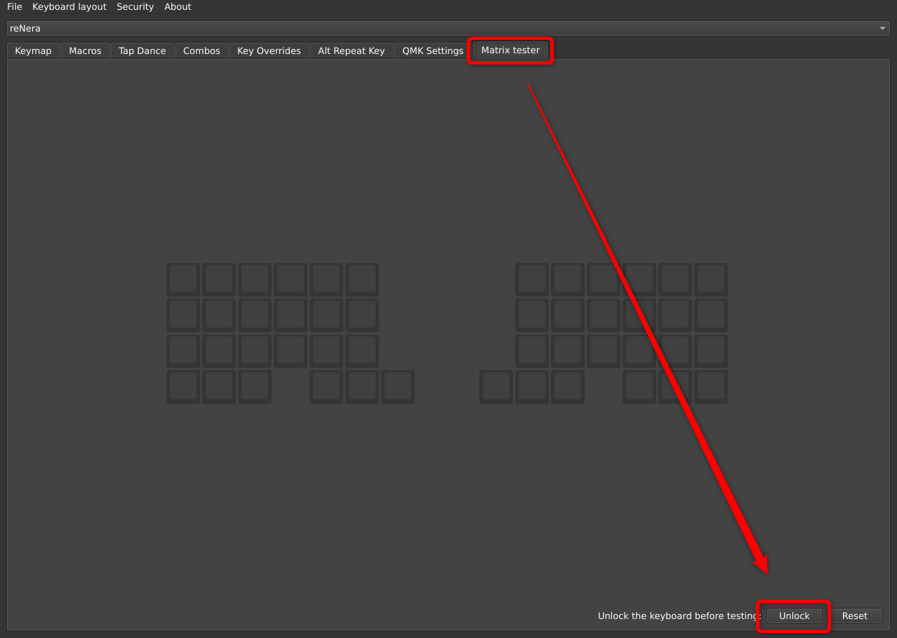
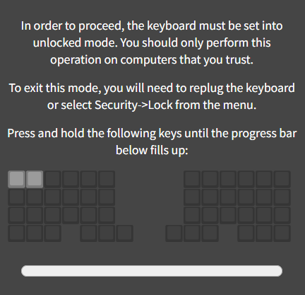

> [!note]
> 本手順はVial対応キーボードの動作確認手順です。
# 前提
WEB版は[こちら](https://vial.rocks/)から利用可能です。  

アプリ版を利用される場合は公式から事前にインストールしてください。

# 手順

以下はWEB版の手順です。  
アプリ版を利用される場合は適宜読み替えてください。

1. キーボードをUSB接続し「Start Vial」をクリックします。   
2. 動作確認するキーボードを選択します。 
3. Matrix tester - Unlock の順にクリックします。
4. 画面に表示される案内に従って、特定のキーを長押しし、ロックを解除します。
5. キーを押下し、全キーが反応することを確認します。