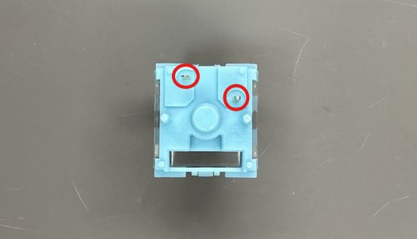
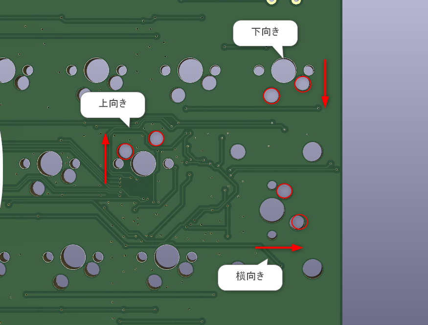
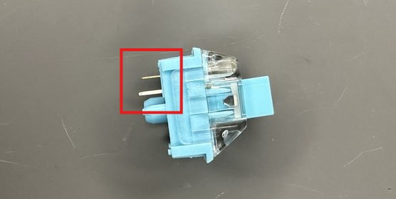

> [!note]
> 本手順はキースイッチの取り付け手順です。
# 前提
キーボードにより対応するキースイッチの規格が異なります。  
事前に対応するキースイッチを確認してください。  

なおキースイッチの規格により若干スイッチの形状が異なりますが、取り付け方法は基本的に同じです。  
必要に応じて、適宜読み替えてください。  

> [!note]
> 2026年10月現在、自作キーボードでよく用いられるキースイッチの規格には以下のようなものがあります。
> - MX互換
> - Choc V1
> - Choc V2
> - Gateron LP 2.0
> - Gateron LP 3.0

# 手順
キースイッチから出ている金属のピンを確認します。  
ほとんどの場合、2本のピンが出ています。  

金属のピンがPCB基板に取り付けられた**キースイッチソケットにハマる向き**でスイッチプレートの上から取り付けていきます。  

なおキーボードによっては、取り付けるキーごとに取り付け向きが異なる場合があります。
キースイッチを取り付ける際は必ず向きを確認しながら実施してください。

またキースイッチを取り付ける際はピンが曲がっていないかひとつひとつ目視で確認することをオススメします。  
挿し込んだ時に妙に抵抗がある場合は無理に力を入れず、ピンの向きや状態を確認してみてください。  

