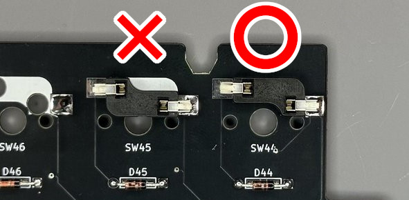
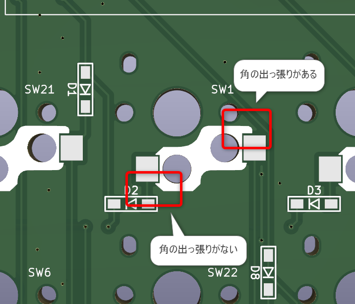
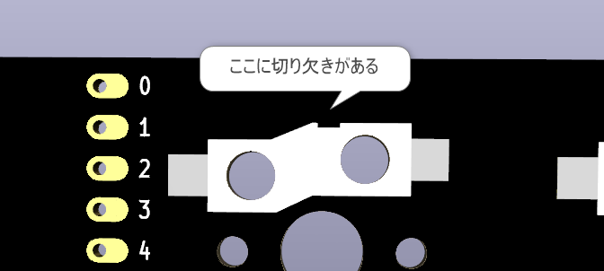
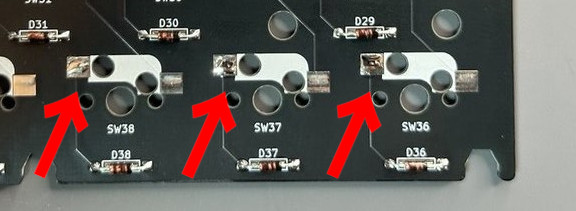
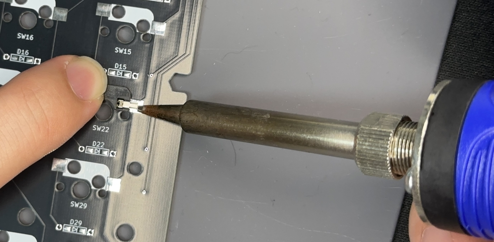
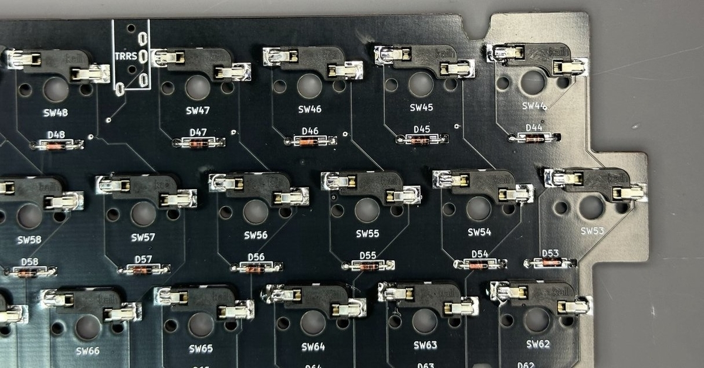

本手順はキースイッチソケットの取り付け手順です。

# 前提
キーボードによって取り付けられるソケットが異なります。  
大きく以下の3種類があり、それぞれ取り付けに向きがあるため注意してください。

### MXスイッチソケット
PCB基板のシルク印刷に合う向きに取り付けてください。

### Chocスイッチソケット
スイッチソケットの角をよく見て、シルク印刷に合わせて取り付けてください。

### Gateron LowProfile 2.0スイッチソケット
スイッチソケットの切り欠きの位置を確認し、シルク印刷に合わせて取り付けてください。

# 手順
ソケット取り付け位置のどちらか片側にだけ少量のはんだを溶かし込みます。

ソケットを押さえながら、先ほど流し込んだ予備はんだを溶かしてソケットを固定します。  
この際、指を火傷しないように注意し、必要に応じてピンセット等の工具も活用してください。

続けてソケットの反対側の端子をはんだづけします。

両側の端子がしっかりハンダ付けされていることを確認したら、キースイッチソケットの取り付けは完了です。