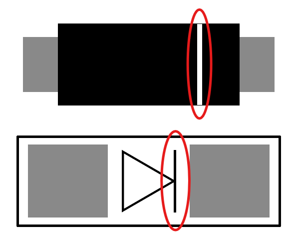
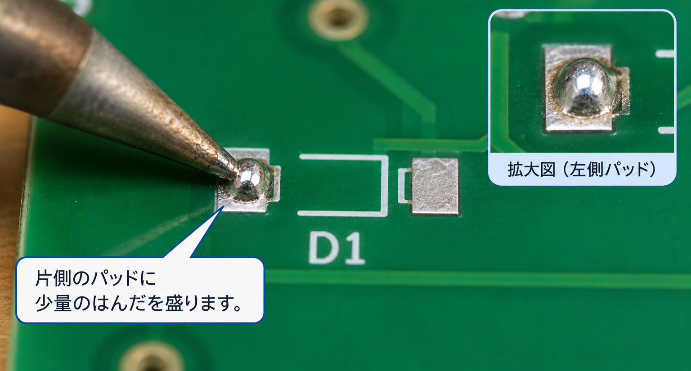
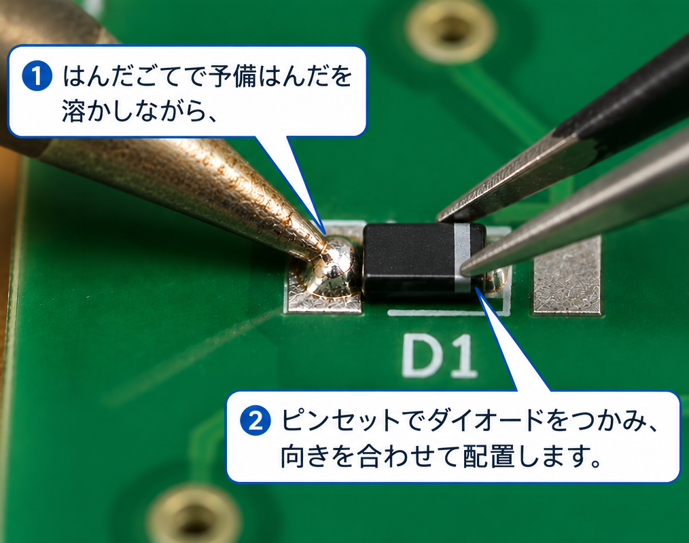

本手順はダイオード（SMDタイプ）の取り付け手順です。

# 前提
## 極性
**ダイオードには極性（取り付ける向き）があります。**
誤った向きで取り付けてしまうとキーが反応しません。    
画像や参考URLを確認し、正しい方向で取り付けてください。  

参考：[ダイオードとは？記号・仕組み・向きについて！](https://detail-infomation.com/diode/)

## 工具
ピンセットがあるとダイオードの取り付けが楽になります。  
ピンセットの挟む動作が苦手な場合は「逆作用ピンセット」の利用も検討してください。

# 手順
> [!NOTE]
> 本記事内の画像は生成AIを利用したイメージ画像です。  
> 実際の作業にあたっては手元のパーツと基板をよく見て作業してください。

基板上のダイオード取り付け位置の片側に、少量のハンダを盛ります（＝予備ハンダ）。  

予備ハンダをハンダごてで溶かしながら、ピンセットでダイオードを配置します。  
**ダイオードの向き（極性）に注意**してください。  

ダイオードが固定されたら、反対側の端子（パッド）もハンダ付けします。

これでダイオード（リードタイプ）の取り付けは完了です。