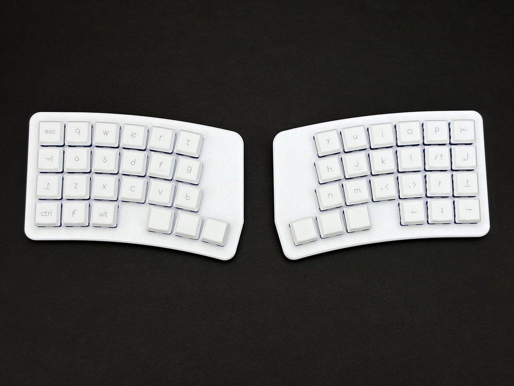

> [!note]
> 本手順は「A'sKey」が頒布する自作キーボードキット「reNera」のビルドガイドです。

[【自作キーボードキット】reNera | A'sKey | アスキー](https://alektor.booth.pm/items/8823344)
# 事前準備
## 同梱品の確認
[BOMファイル](reNera_BOM.md)を参考に、届いたキットに同梱されているパーツに不足がないか確認します。  
もしも不足があった場合は、BOOTHのショップメッセージからご連絡ください。

## パーツの準備
[BOMファイル](reNera_BOM.md)を参考に、ご自身で用意が必要な部品を調達します。

## 工具の準備
自作キーボードの組み立てに必要な工具を用意します。  

reNeraの組み立てには概ね
- ハンダごて
- ニッパー
- ドライバー
- ピンセット
があれば組み立て可能です。  

詳しくは[こちら](https://alektor.hatenablog.com/entry/2024/10/17/180000)や[こちら](https://note.com/teporz/n/n470c54151472)などを参考にご用意ください。

# 組み立て手順
## ハンダ付け
以下の順にハンダ付けを行います。  
詳細な手順は各リンク先をご確認ください。

1. [ダイオードの取り付け](../../common/ダイオード（SMDタイプ）.md)
2. [キースイッチソケットの取り付け](../../common/キースイッチソケット.md)
3. [TRRSジャックの取り付け](../../common/TRRSジャック.md)
4. [RP2040-Zeroの取り付け](../../common/RP2040-Zero（ピンヘッダー・コンスルー）.md)

## ファームウェア書き込み
詳細な手順は各リンク先をご確認ください。

- [RP2040-Zero ファームウェア書き込み](../../common/RP2040-Zero_ファームウェア書き込み.md)

## 動作確認

## ケース組み立て

## キースイッチ・キーキャップ取り付け

# 完成したら